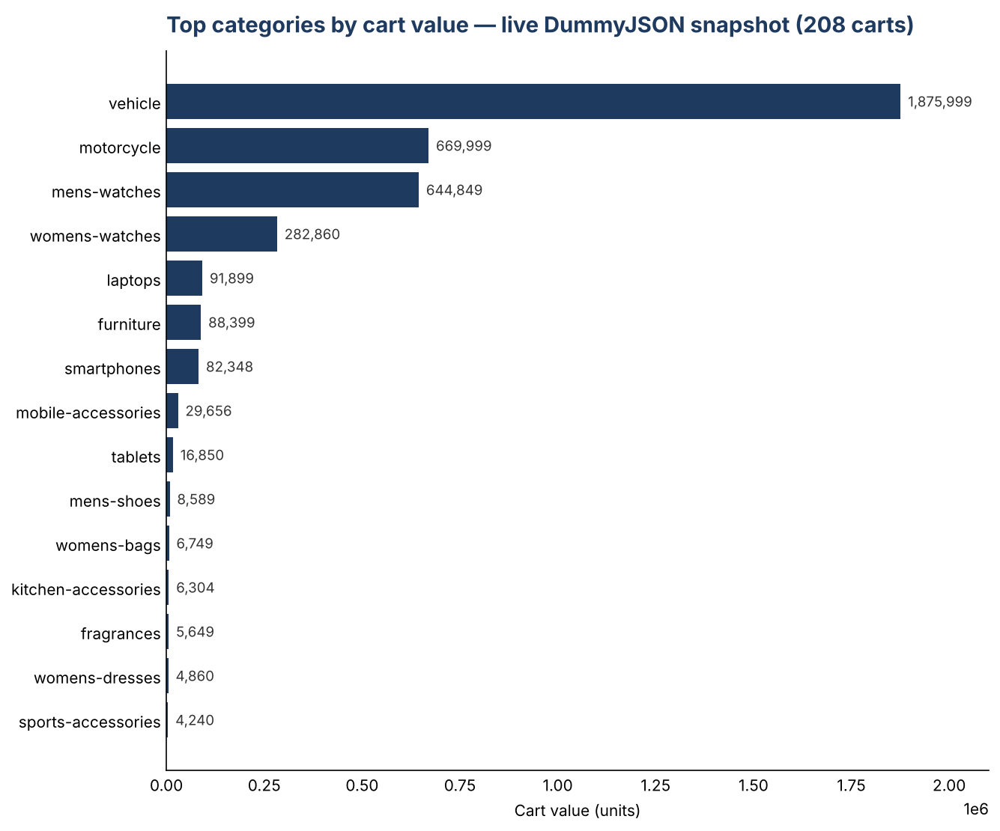
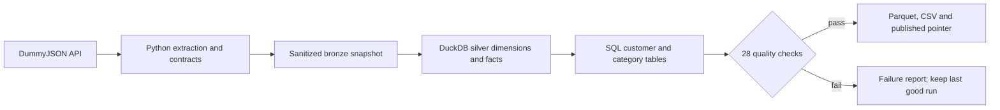

# Customer360 pipeline

[](https://github.com/mohamedmoatazsec/customer360-pipeline/actions/workflows/ci.yml)


A customer analytics pipeline built with **Python, SQL, DuckDB, pandas and PySpark**. It extracts customers, products and shopping carts from a public API, validates them, and publishes customer and category tables only when all quality checks pass — then turns the result into an Excel dashboard and a Power BI–ready star schema.

This is a portfolio project using **DummyJSON's synthetic data**. Carts are shopping baskets, not completed purchases: the outputs describe cart activity and value, not revenue or customer lifetime value.



## What it demonstrates

- Complete API extraction with pagination, bounded retries, timeouts and schema checks.
- Explicit data contracts; nested cart products become a table at cart/source-line grain.
- SQL joins, common table expressions, aggregates and a window function to select each customer's top category.
- Monetary values stored as integer cents; 28 SQL checks gate publication.
- Immutable run folders, a stable input fingerprint and an atomic `current.json` pointer. A bad run leaves the last good snapshot available.
- The **same gold transform in three engines** — SQL (DuckDB), pandas and PySpark — each cross-checked against one shared expected result, so the logic is proven independent of any single tool.
- A **pandas BI layer** that publishes an Excel dashboard with native charts, a ranked category chart, and a Power BI–ready star schema.
- Automated tests and CI; a dedicated workflow runs the PySpark engine, and a separate manual workflow checks the real API.

## Run it

Requires Python 3.11 or newer. From the repository root:

```sh
python -m venv .venv
# Windows PowerShell:
.venv\Scripts\Activate.ps1
# macOS/Linux: source .venv/bin/activate
python -m pip install -e ".[dev]"

# Reproducible offline example, no account or API key:
python -m customer360 run --fixture tests/fixtures/sample.json --output data/demo

# Current data from the public API:
python -m customer360 run --output data/live

# Build the Excel dashboard, category chart and Power BI export (pandas engine):
python -m pip install -e ".[analytics]"
python -m customer360 report --fixture tests/fixtures/sample.json --output data/report

python -m pytest
python -m ruff check .
```

The `report` command writes `customer360_dashboard.xlsx` (Overview, By segment, By category — each with a native chart), `dashboard.png`, and a `powerbi/` star schema. The PySpark engine is exercised by the `Spark engine` CI workflow; install it locally with `pip install -e ".[spark]"`.

Both commands print a JSON run summary. `data/live/current.json` points to the latest successful run; resolve its `run_dir` relative to `data/live` before reading artifacts. Do not assume the newest directory is a published run.

```text
data/live/
  current.json
  runs/<run_id>/
    run.json                 # source, times, counts, input and SQL hashes, runtime
    quality.json             # every SQL check and its failure count
    bronze/*.json            # allowlisted, normalized source fields
    warehouse.duckdb         # bronze tables, silver dimensions/facts, gold tables
    gold/customer_360.parquet
    gold/category_summary.parquet
    gold/*.csv
  failures/<run_id>.json      # safe diagnostics; no source records
```

## The data model



| Table | Grain | Purpose |
|---|---|---|
| `silver.dim_customer` | One source customer | Contact pseudonym and broad location |
| `silver.dim_product` | One source product | Product category and current list price |
| `silver.fact_cart` | One source cart | Cart header amounts and quantities |
| `silver.fact_cart_item` | One source line in one cart | Quantities, cart-time prices and discounts |
| `gold.customer_360` | One source customer, including those without carts | Counts, quantities, cart values, top category, activity segment |
| `gold.category_summary` | One category with cart activity | Cart count, quantity and value by category |

Customer totals aggregate the cart header **before** joining to customers. Category preference aggregates item values independently; ties use category name ascending. This prevents a common join error where a cart's value is counted once for every item.

## Inspect the result

The following Python snippet uses the published pointer and queries the database without changing it:

```python
import json
from pathlib import Path
import duckdb

root = Path("data/live")
run = json.loads((root / "current.json").read_text(encoding="utf-8"))
with duckdb.connect(str(root / run["run_dir"] / "warehouse.duckdb"), read_only=True) as db:
    print(
        db.sql("""
        SELECT engagement_segment, COUNT(*) AS customers,
               SUM(cart_value_cents) / 100.0 AS cart_value
        FROM gold.customer_360
        GROUP BY engagement_segment
        ORDER BY engagement_segment
    """).fetchall()
    )
```

See [the recorded live run](docs/evidence/live-run.md) for measured results, [the contracts and design decisions](docs/design.md), and [the operating guide](docs/runbook.md) for failure recovery and the CI workflow.

## Engines and BI

The gold transform is written three ways against one contract:

| Engine | Module | Runs in | Use |
|---|---|---|---|
| SQL on DuckDB | `sql/transform.sql` | Default test suite | The production path; also builds the warehouse and runs the 28-check quality gate |
| pandas | `pandas_transform.py` | Default test suite | Portable in-process reference; feeds the BI layer |
| PySpark | `spark_transform.py` | `Spark engine` workflow | Databricks-style DataFrame implementation |

`tests/test_engines.py` asserts all three produce identical gold rows from the same bronze
snapshot. The pandas result feeds `reporting.py`, which publishes the Excel dashboard, the
category chart above, and the [Power BI star schema](docs/powerbi.md).

## Scope and limits

This is a small **full-snapshot ELT** implementation. It does not claim incremental CDC, identity resolution across systems, real-time processing, production scale, or a deployed customer data platform. DuckDB is the default engine and makes the SQL and columnar outputs reproducible on a laptop. The pandas and PySpark engines are portable reference implementations of the same contract, cross-checked in CI — this is still a laptop-scale project, not a deployed Databricks job, and Delta Live Tables and Kafka are not used.

The bronze layer is already sanitized and normalized; it is not a lossless raw archive. The checked-in fixture reproduces the offline example. Live API data can change, and the provider offers no transactional snapshot across endpoints. A stable total is checked during pagination; it cannot detect every possible source mutation.

Only synthetic records are used. Email is normalized and hashed before persistence; the hash is a **pseudonym, not anonymization**. Passwords, names, street addresses, phone numbers, bank details and government identifiers are never written by the pipeline. Production contact processing would require a separate privacy and key-management design.

Author: [Mohamed Moataz](https://github.com/mohamedmoatazsec) · [LinkedIn](https://www.linkedin.com/in/mohamedmoatazsec)

Source documentation: [DummyJSON users](https://dummyjson.com/docs/users), [products](https://dummyjson.com/docs/products), [carts](https://dummyjson.com/docs/carts), [DuckDB Parquet](https://duckdb.org/docs/stable/data/parquet/overview).
